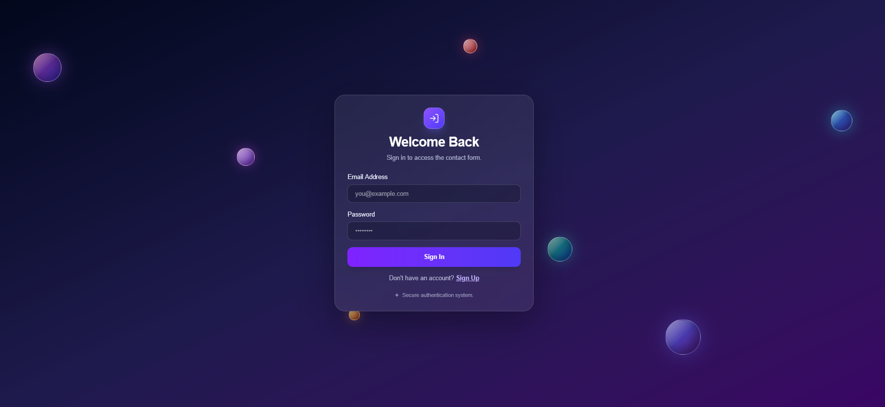
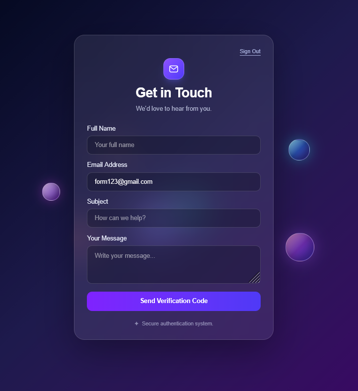
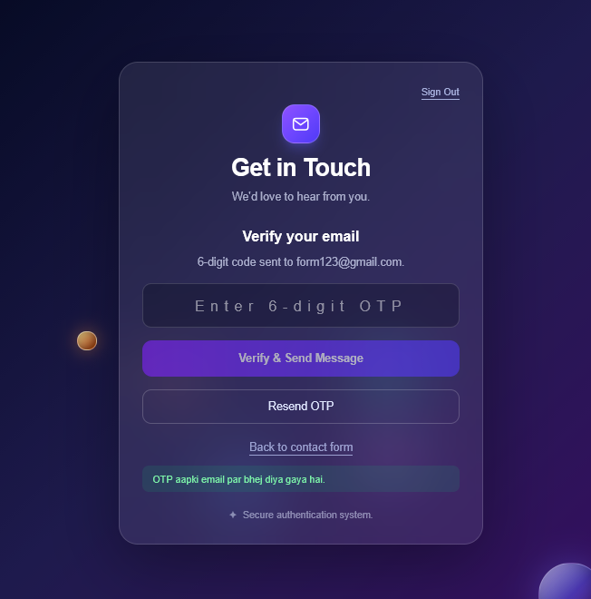

## Contact Form Application

A modern, responsive full-stack web application with user authentication, OTP-based email verification, and a secure contact form.

## Overview

**Contact Form** lets users create an account, sign in, verify an email address with a one-time password (OTP), and submit a message through the contact form. The frontend is built with React and Vite, while the backend uses Node.js, Express, and MongoDB.

## Features

- **User authentication** — Sign up and sign in with an email address and password.
- **Password security** — Passwords are hashed using `bcryptjs`.
- **JWT authentication** — Token-protected API routes.
- **Email verification** — OTP-based email verification.
- **Contact form** — Submit a name, email address, subject, and message.
- **MongoDB storage** — Mongoose models store user and OTP verification data.
- **Rate limiting** — Limits repeated authentication and OTP requests.
- **Responsive UI** — Layout designed for desktop and smaller screens.
- **Animated background** — Floating sphere effects in the interface.

## Technology Stack

### Frontend
- React
- Vite
- Tailwind CSS

### Backend
- Node.js
- Express.js
- MongoDB
- Mongoose
- JSON Web Token (`jsonwebtoken`)
- `bcryptjs`
- Nodemailer
- `express-rate-limit`

> **Note:** Add Three.js / React Three Fiber to this list only if they are installed and used in the current project. The supplied `App.jsx` shows animated spheres implemented with CSS.

## Screenshots

Place your screenshots in a folder named `screenshots/` in the project root. Use the filenames below, or update the paths to match your actual filenames.

<table>
  <tr>
    <td align="center"><strong>Login &amp; Registration</strong></td>
    <td align="center"><strong>Contact Form</strong></td>
    <td align="center"><strong>OTP Verification</strong></td>
  </tr>
  <tr>
    <td align="center"></td>
    <td align="center"></td>
    <td align="center"></td>
  </tr>
</table>

**Screenshot sizing:** Each image uses the same display width and height so the screenshot previews appear consistently sized on GitHub. Replace these example image paths with your real screenshot filenames. GitHub may not honor every HTML styling attribute, but the fixed `width` and `height` attributes keep the displayed dimensions consistent.

## Getting Started

### Prerequisites

Install or prepare the following:

- [Node.js](https://nodejs.org/) and npm
- A MongoDB database (local MongoDB or MongoDB Atlas)
- A Gmail account with an App Password, if Gmail is used to send email

### 1. Clone the repository

Replace `YOUR_GITHUB_REPOSITORY_URL` with your repository's actual URL.

```bash
git clone YOUR_GITHUB_REPOSITORY_URL
cd sphere-form
```

### 2. Install frontend dependencies

Run this command from the project root:

```bash
npm install
```

### 3. Install backend dependencies

```bash
cd backend
npm install
```

### 4. Configure environment variables

Create a `.env` file inside the `backend/` directory:

```env
PORT=5000
MONGO_URI=your_mongodb_connection_string
JWT_SECRET=your_long_random_secret
EMAIL_USER=your_email_address
EMAIL_APP_PASSWORD=your_gmail_app_password
RECEIVER_EMAIL=your_receiver_email
CLIENT_ORIGIN=http://localhost:5173
```

Replace all example values with your own. Keep the real `.env` file private and **never commit credentials, tokens, or database connection strings to GitHub**.

### 5. Start the backend

From the `backend/` directory, run the command supported by your `backend/package.json`. For example:

```bash
npm start
```

If your `package.json` does not define a `start` script, use the script it does define (such as `npm run dev`) or run `node server.js`.

The backend uses port `5000` by default. Visit [http://localhost:5000](http://localhost:5000) to check the root route.

### 6. Start the frontend

Open a second terminal, return to the project root, and run:

```bash
npm run dev
```

Vite will print the local frontend URL, typically [http://localhost:5173](http://localhost:5173).

## Deployment

The application can be deployed with services such as:

- **Frontend:** Vercel or Netlify
- **Backend:** Render or another Node.js hosting provider
- **Database:** MongoDB Atlas

Before deploying:

1. Add the backend environment variables in your hosting provider's settings.
2. Set `CLIENT_ORIGIN` to the deployed frontend URL.
3. Set `VITE_API_URL` in the frontend environment to the deployed backend URL.
4. Redeploy the frontend after changing its environment variables.
5. Test signup, login, OTP delivery, and contact message delivery in production.

## Security Notes

- Do not commit `.env` files or expose private credentials.
- Use a strong, random `JWT_SECRET`.
- Use a Gmail App Password rather than your normal Gmail password when using Gmail SMTP.
- Keep authentication and OTP endpoints protected and rate-limited.
- Configure CORS for the intended frontend origin in production.
- Do not publish real OTPs, tokens, or database credentials in screenshots or logs.

## Project Status

The project is under development and being prepared for deployment. Update this section when the production deployment is complete.

## License

No license has been specified. Unless you add a license, others generally do not receive an explicit license to reuse, modify, or redistribute the project.
